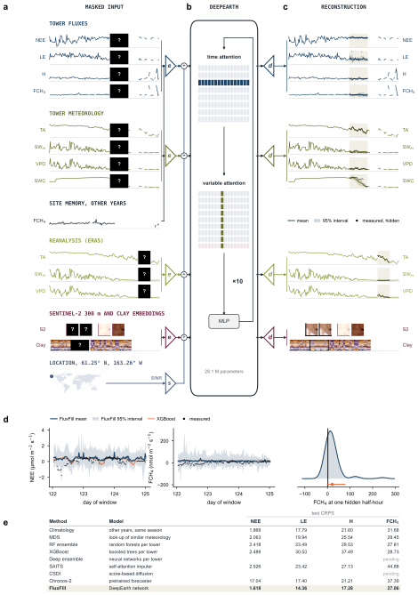
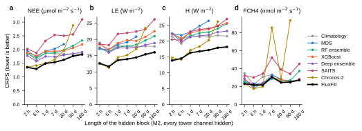

# FluxFill

FluxFill is a self-supervised AI foundation model trained to reconstruct masked and missing flux data, based on the
DeepEarth neural network architecture. It predicts a distribution for any hidden part of a 180-day window of
half-hourly data at one eddy-covariance tower: the fluxes of carbon dioxide (NEE), latent heat (LE), sensible heat (H)
and methane (FCH4), the tower's meteorology, reanalysis drivers, and Clay embeddings of Sentinel-2 images. One network
is trained on 488 towers. Station outages remove 26 % of the record at those towers, and 42 % of that time lies in
outages of 7 days or longer. On FluxFill-Bench, 514 windows at 131 test towers at least 50 km from any training tower,
its CRPS is 14.2 % lower than the best established method for NEE, 17.7 % for LE, 18.1 % for H and 3.6 % for FCH4 on
the values every method fills, with 95 % intervals that contain 0.948 to 0.955 of hidden values. It has the lowest
CRPS for NEE, LE and H at every gap from 1 to 180 days. Chronos-2 and XGBoost lead at the shortest gaps, and FCH4 by
gap is open: FluxFill leads 2 of its 11 gap classes. These test scores are from the network trained for 24,000 steps;
the final network (48,000 steps with a temporal copula) is scored once on these windows at the end of the component
study.

Work of the Quantitative Ecosystem Dynamics lab, University of California, Berkeley, sponsored by Ecological
Intelligence, Inc. Authors: Mira Shivani Sankar (mirashivanisankar@berkeley.edu), Lance Legel (legel@berkeley.edu),
Trevor Keenan (trevorkeenan@berkeley.edu).

Dashboard and full report: [deepearth.ai/fluxfill](https://deepearth.ai/fluxfill). Benchmark specification:
[docs/BENCHMARK.md](docs/BENCHMARK.md).

[](docs/figure1.svg)

## Equations

A window of a tower is a tensor $`\mathbf{X} \in \mathbb{R}^{V \times D \times K}`$ of $`V`$ variables, $`D = 180`$ days
and $`K = 48`$ half-hours, with $`O_{vdk} = 1`$ where the source measured the value. A mask $`\mathbf{M}`$ hides values:
the hidden set is $`\mathcal{H} = \{(v,d,k) : O_{vdk} = 1, M_{vdk} = 1\}`$, the visible set
$`\mathcal{V} = \{(v,d,k) : O_{vdk} = 1, M_{vdk} = 0\}`$. A method receives $`\mathbf{X}_\mathcal{V}`$, the imagery and
the tower's other calendar years; every score is computed on $`\mathcal{H}`$.

Inputs ([`data.py`](model/data.py), [`memory.py`](model/memory.py), [`net.py` `encode`](model/net.py#L517)):

| process | equation | code |
|---|---|---|
| values | $`z_{vdk} = (x_{vdk} - \mu_v) / \sigma_v`$, $`\mu_v, \sigma_v`$ over the training towers | [`data.py` `fit_stats`](model/data.py#L288), [`window_tokens`](model/data.py#L330) |
| site memory | $`\mu^{\mathrm{mem}}_{vdk} = \sum_{\lvert d' - d \rvert \le 15} S^1_{vd'k} / \sum_{\lvert d' - d \rvert \le 15} N_{vd'k}`$, the mean of the tower's measured values at the same half-hour within ±15 days of the day of year, in its other calendar years; $`\sigma^{\mathrm{mem}}`$ from the second moment; $`n^{\mathrm{mem}} = 1`$ with at least 3 values | [`memory.py` `memory_from_sums`](model/memory.py#L66), [`smooth_doy`](model/memory.py#L57) |
| day token | $`e_{vd} = A\,[\,z_{vd} \odot o_{vd};\ o_{vd};\ \mu^{\mathrm{mem}}_{vd} n^{\mathrm{mem}}_{vd};\ \sigma^{\mathrm{mem}}_{vd} n^{\mathrm{mem}}_{vd};\ n^{\mathrm{mem}}_{vd}\,]`$, $`o_{vd}`$ the 48 visible flags; a token without visible values takes a learned mask vector and keeps its memory channels | [`net.py` `encode`](model/net.py#L517) |
| imagery token | one per day: the Clay v1.5 class token $`\mathbf{c}_d \in \mathbb{R}^{1024}`$ of that day's chip, normalised and projected, with its cloud, shadow and clear fractions | [`imagery.py` `window_imagery`](model/imagery.py#L47) |
| position | added to every token: learned embeddings of variable, provenance (tower, reanalysis, reanalysis-land, imagery) and day of window, two annual harmonics, and the location | [`net.py` `encode`](model/net.py#L517) |
| location | SINR's network on $`(\sin, \cos)(\pi\,\mathrm{lon}/180)`$, $`(\sin, \cos)(\pi\,\mathrm{lat}/90)`$ and elevation; zero for a hidden location | [`net.py` `SinrPlace`](model/net.py#L66) |

The network and its predictive distribution ([`net.py` `FluxFillNet`](model/net.py#L370)):

| process | equation | code |
|---|---|---|
| encoder | $`\mathbf{h} = f_\theta(\mathbf{X}_\mathcal{V}, \mathbf{O} \odot (1 - \mathbf{M}), \mu^{\mathrm{mem}}, \sigma^{\mathrm{mem}}, n^{\mathrm{mem}}, \mathbf{C}, \mathbf{s})`$: 10 blocks of width 320 with 8 heads, alternating attention over the 180 days of a variable, with a rotary encoding of the day index, and attention across the variables of a day; 28,118,489 parameters | [`Block`](model/net.py#L311), [`encode`](model/net.py#L517) |
| predictive distribution | $`p_\theta(x_{vdk} \mid \mathbf{h}_{vd}) = \pi_{vdk}\, t_{\nu^1}(x_{vdk};\, b^1_{vdk} + m^1_{vdk},\, s^1_{vdk}) + (1 - \pi_{vdk})\, t_{\nu^2}(x_{vdk};\, b^2_{vdk} + m^2_{vdk},\, s^2_{vdk})`$, Student-t with $`\nu \gt 2`$; $`m, s, \nu, \pi`$ read from $`\mathbf{h}_{vd}`$ by a two-layer network | [`StudentTHead`](model/net.py#L722), [`marginal_nll`](model/net.py#L768) |
| local anchor | $`b^1_{vdk} = \bar{x}^{\mathrm{loc}}_{vdk} + \rho_v^{\Delta_{vdk}}\, a^{\mathrm{edge}}_{vdk}`$: the mean of visible values at half-hour $`k`$ on the days within ±3 (at least 2 values), plus the anomaly of the nearest visible value, decaying with the distance $`\Delta`$ in half-hours; $`\rho_v \in (0, 1)`$ learned per variable | [`local_course_stats`](model/net.py#L705), [`edge_anomaly`](model/net.py#L681), [`gated_params`](model/net.py#L590) |
| memory anchor | $`b^2_{vdk} = \mu^{\mathrm{mem}}_{vdk} + c^{\mathrm{near}}_v A^{\mathrm{near}}_{vdk} + c^{\mathrm{win}}_v A^{\mathrm{win}}_{vdk}`$: site memory plus the window's departure from it, weighted $`e^{-\lvert d - d' \rvert / 10}`$ near the day and uniformly over the window; $`c`$ learned per variable | [`year_anomalies`](model/net.py#L646), [`gated_params`](model/net.py#L590) |
| gate | $`\mathrm{logit}\,\pi_{vdk} \leftarrow \mathrm{logit}\,\pi_{vdk} + g^\top \phi_{vdk}`$, $`s^c_{vdk} \leftarrow s^c_{vdk}\, e^{g_c^\top \phi_{vdk}}`$, with evidence $`\phi = [\,n^{\mathrm{loc}} / 6,\ \log(1 + \Delta) / \log 8640,\ n^{\mathrm{mem}},\ [\text{local course exists}]\,]`$; without a local course only the memory component remains | [`gated_params`](model/net.py#L590) |
| imagery head | $`\mathcal{N}(\tilde{\mathbf{c}}_d;\, \mu_\theta(\mathbf{h}_{Id}),\, \mathrm{diag}\,\sigma^2_\theta(\mathbf{h}_{Id}))`$ of the normalised Clay embedding of a hidden day | [`imagery_scores`](model/net.py#L822) |
| flow head | velocity $`u_\theta(\mathbf{z}_\tau, \tau, \mathbf{h}_{vd})`$ on the residual $`\mathbf{r}_{vd} = \mathbf{x}_{vd} - \mu^{\mathrm{mem}}_{vd}`$, $`\mathbf{z}_\tau = (1 - \tau)\epsilon + \tau\, \mathbf{r}_{vd}`$; trained jointly as an auxiliary task; the scores below use the Student-t mixture | [`FlowHead`](model/net.py#L872) |

Training ([`train.py`](model/train.py), [`masking.py`](model/masking.py)):

| process | equation | code |
|---|---|---|
| masks | each window draws one family: a block of every tower channel of 1 to 180 days, log-uniform (0.35); a mix of that block and short gaps (0.20); an independent block per variable (0.20); short gaps of 1 to 64 half-hours (0.15); every tower channel over the whole window (0.10). On top, all tower meteorology, ONEFlux reanalysis or reanalysis-land is removed (0.15 each), all imagery (0.30), and each imagery day (0.15). With probability 0.5 a random share of the hidden tokens is shown again, the partly generated states of masked generation | [`masking.py` `MaskConfig`](model/masking.py#L27), [`draw`](model/masking.py#L57) |
| objective | $`\mathcal{L} = \frac{1}{\lvert \mathcal{H} \rvert} \sum_{\mathcal{H}} -\log p_\theta(x_{vdk} \mid \mathbf{h}_{vd}) + \lambda_{\mathrm{img}} \mathcal{L}_{\mathrm{img}} + \mathcal{L}_{\mathrm{flow}}`$, $`\lambda_{\mathrm{img}} = 0.1`$ | [`train.py` `losses`](model/train.py#L189) |
| imagery | $`\mathcal{L}_{\mathrm{img}} = \frac{1}{\lvert \mathcal{H}_I \rvert} \sum_{d \in \mathcal{H}_I} -\log \mathcal{N}(\tilde{\mathbf{c}}_d;\, \mu_\theta,\, \mathrm{diag}\,\sigma^2_\theta)`$ | [`imagery_scores`](model/net.py#L822) |
| flow matching | $`\mathcal{L}_{\mathrm{flow}} = \mathbb{E}_{\tau, \epsilon}\, \lVert \mathbf{m}_{vd} \odot (u_\theta - (\mathbf{r}_{vd} - \epsilon)) \rVert_2^2 / \lVert \mathbf{m}_{vd} \rVert_1`$ over at most 2,048 hidden tokens of a step, four $`(\tau, \epsilon)`$ pairs each | [`FlowHead.loss`](model/net.py#L897) |
| update | AdamW, $`\beta = (0.9, 0.98)`$, weight decay 0.05, gradient norm clipped at 1; rate rises to $`3 \times 10^{-4}`$ over 500 steps, then cosine decay; 48,000 steps of 8 windows, 0.49 s a step and 6.6 h on one RTX 3090 | [`train.py` `main`](model/train.py#L362) |

Filling a window ([`method.py` `FluxFill`](model/method.py#L42)):

| process | equation | code |
|---|---|---|
| marginals | $`F_{vt}`$, the predictive distribution of half-hour $`t`$ | [`predict`](model/method.py#L134), [`sample_marginal`](model/method.py#L170) |
| temporal copula | $`g_{vt} = \sqrt{w_v}\, a^{\mathrm{s}}_{vt} + \sqrt{1 - w_v}\, a^{\mathrm{f}}_{vt}`$, $`a_{vt} = \rho\, a_{v,t-1} + \sqrt{1 - \rho^2}\, \epsilon_{vt}`$, $`\rho = e^{-1/L}`$, and $`x^{(i)}_{vt} = F^{-1}_{vt}(\Phi(g^{(i)}_{vt}))`$ with 64 samples; the mixture component comes from a second field of the same law. Each half-hour keeps its marginal distribution; only sums change | [`sample_copula`](model/method.py#L182) |
| copula fit | $`\rho(k) = w\, e^{-k/L^{\mathrm{s}}} + (1 - w)\, e^{-k/L^{\mathrm{f}}}`$ by least squares on the autocorrelation of normal scores $`\Phi^{-1}(F(y))`$ of hidden validation values, lags from one half-hour to 30 days | [`copula_fit.py`](model/copula_fit.py#L36), [`copula_final.json`](model/copula_final.json) |

Fitted copula parameters ($`L`$ in half-hours; 48 half-hours are one day):

| flux | $`w`$ | $`L^{\mathrm{s}}`$ | $`L^{\mathrm{f}}`$ |
|---|---|---|---|
| NEE | 0.195 | 3,315 | 1.34 |
| LE | 0.193 | 1,972 | 2.70 |
| H | 0.136 | 2,098 | 2.94 |
| FCH4 | 0.391 | 2,021 | 1.63 |

Scores ([`bench/metrics.py`](bench/metrics.py)):

| score | equation | code |
|---|---|---|
| CRPS | $`\mathrm{CRPS}(F, y) = \int (F(z) - \mathbb{1}\{y \le z\})^2\, dz`$; from samples with the fair estimator $`\frac{1}{S}\sum_i \lvert x^{(i)} - y \rvert - \frac{1}{2S(S-1)}\sum_{i \ne j} \lvert x^{(i)} - x^{(j)} \rvert`$, $`S = 64`$ | [`crps_samples`](bench/metrics.py#L18) |
| coverage | share of hidden values inside the central 50, 80 and 95 % intervals | [`coverage_samples`](bench/metrics.py#L59) |
| sums | $`\Sigma^{(i)}_B = \sum_{(d,k) \in B} x^{(i)}_{vdk}`$ per sample, over each day, each 30-day block and the whole window, scored with CRPS and coverage | [`block_sums`](bench/metrics.py#L98) |
| point scores | of the predictive mean: MAE, RMSE, bias, $`R^2 = 1 - \sum_\mathcal{H} (\hat{x} - x)^2 / \sum_\mathcal{H} (x - \bar{x})^2`$, $`\mathrm{WAPE} = 100 \sum_\mathcal{H} \lvert \hat{x} - x \rvert / \sum_\mathcal{H} \lvert x \rvert`$ | [`point_scores`](bench/metrics.py#L111) |

## Departures from published gap filling

| | published methods | here |
|---|---|---|
| targets | one flux at a time, from drivers that fail in the same outage | one model of every variable; every modality can be hidden |
| training | one tower | 488 towers; a new tower needs no fitting |
| ecosystem state | vegetation indices, at best | every Sentinel-2 acquisition over 300 m × 300 m, embedded by Clay |
| uncertainty | evaluated on the gaps of short-gap benchmarks, or none | a predictive distribution for every value, scored with the CRPS and interval coverage at every gap length |
| sums | spread of independent samples | samples coupled in time, scored as sums |
| benchmark | artificial gaps, mostly short | real outage lengths to 180 days, at towers at least 50 km from any training tower, windows and masks frozen before fitting |

The review of the published methods is [docs/LITERATURE.md](docs/LITERATURE.md).

## Benchmark

FluxFill-Bench release 0.2 holds 514 windows of 180 days at 131 test towers, frozen with SHA-256 hashes of the split,
windows and masks ([`bench/freeze.py`](bench/freeze.py), [`bench/release/0.2`](bench/release/0.2)). The runner recomputes
each mask and refuses to score a window whose mask differs. Only values the source flags as measured enter, as inputs
or as targets. Towers within 50 km of each other go wholly to one split: 488 training, 54 validation, 136 test; the
release covers 131 of the test towers. Every method receives the window with the hidden values removed and the tower's other
calendar years, and returns at least 64 samples per hidden value ([`bench/run.py`](bench/run.py)).

| family | what is hidden | code |
|---|---|---|
| M1 | gaps that, merged with the real gaps, reproduce the tower's gap-length distribution (Irvin et al. 2021) | [`irvin_gaps.py`](bench/irvin_gaps.py) |
| M2 | every tower channel over one block of 2 h, 6 h, 1, 7, 30, 90 or 180 days | [`masks.py` `contiguous_block`](bench/masks.py#L45) |
| M3 | the real joint outage of all tower channels from a training site-year | [`masks.py` `transplanted_outage`](bench/masks.py#L87) |
| M4 | the reanalysis drivers, with a 30-day M2 block | [`masks.py` `modality_dropout`](bench/masks.py#L110) |
| M5 | an independent block per variable, one half-hour to 90 days, and one whole modality | [`masks.py` `mixed_blocks`](bench/masks.py#L59) |

Established methods ([baselines/README.md](baselines/README.md) lists each port and every change):

| method | source | fitted on | uncertainty |
|---|---|---|---|
| climatology | same half-hour, ±15 days, other years | tower history | empirical pool |
| MDS | Reichstein et al. 2005; REddyProc 1.3.2 | visible window | spread of look-up values |
| RF ensemble | Irvin et al. 2021, released harness | per window | Platt-scaled ensemble |
| XGBoost | Liu et al. 2025, released code | per window | multi-quantile |
| deep ensemble | Vekuri et al. 2025, ported to PyTorch | per window | ensemble and Laplace noise |
| SAITS | Du et al. 2023, PyPOTS 1.5 | training towers | residual Gaussian |
| CSDI | Tashiro et al. 2021, PyPOTS 1.5 | training towers | diffusion samples |
| Chronos-2 | Ansari et al. 2025, amazon/chronos-2 | pretrained | quantiles |

## Results

Test towers, families M2, M3 and M4, hidden measured values, cells (tower, window, mask, variable) that every method
fills completely. FluxFill here is the network of width 320 and depth 10 at 24,000 steps, with independent samples.
Bold marks the best of each column within a flux (coverage: closest to 0.95; bias: closest to 0).

| flux | method | CRPS | 95 % cov. | MAE | RMSE | bias | R² | WAPE |
|---|---|---:|---:|---:|---:|---:|---:|---:|
| **NEE** (µmol m⁻² s⁻¹; 2,536 cells, 932,535 values) | Climatology | 1.813 | 0.883 | 2.516 | 4.519 | 0.023 | 0.604 | 53.9% |
|  | MDS | 2.038 | 0.719 | 2.611 | 4.654 | −0.035 | 0.580 | 55.9% |
|  | RF ensemble | 2.408 | 0.875 | 3.200 | 5.446 | −0.503 | 0.425 | 68.5% |
|  | XGBoost | 2.493 | 0.772 | 3.256 | 5.518 | 0.245 | 0.410 | 69.7% |
|  | SAITS | 2.478 | 0.945 | 2.985 | 4.954 | 0.401 | 0.524 | 63.9% |
|  | Chronos-2 | 19.79 | 0.934 | 294.0 | 26612.4 | −281.6 | −1.4e7 | 6292.5% |
|  | **FluxFill** | **1.556** | **0.953** | **2.138** | **3.908** | **0.022** | **0.704** | **45.8%** |
| **LE** (W m⁻²; 2,844 cells, 1,442,905 values) | Climatology | 17.51 | 0.905 | 24.67 | 45.29 | −0.322 | 0.678 | 49.1% |
|  | MDS | 19.91 | 0.741 | 25.69 | 47.11 | −2.008 | 0.652 | 51.1% |
|  | RF ensemble | 23.95 | 0.886 | 31.75 | 55.81 | −3.888 | 0.511 | 63.2% |
|  | XGBoost | 31.90 | 0.729 | 42.91 | 70.48 | 15.47 | 0.221 | 85.4% |
|  | SAITS | 23.48 | 0.931 | 26.92 | 49.29 | −8.210 | 0.619 | 53.6% |
|  | Chronos-2 | 17.30 | 0.941 | 24.42 | 44.80 | **0.014** | 0.685 | 48.6% |
|  | **FluxFill** | **14.25** | **0.955** | **19.80** | **37.51** | −2.517 | **0.779** | **39.4%** |
| **H** (W m⁻²; 2,912 cells, 1,601,431 values) | Climatology | 21.44 | 0.902 | 30.58 | 48.80 | **0.219** | 0.689 | 55.9% |
|  | MDS | 24.92 | 0.707 | 32.18 | 50.75 | −1.844 | 0.664 | 58.8% |
|  | RF ensemble | 29.85 | 0.886 | 39.69 | 63.63 | −5.254 | 0.471 | 72.6% |
|  | XGBoost | 38.99 | 0.706 | 50.08 | 81.26 | 11.93 | 0.137 | 91.6% |
|  | SAITS | 27.32 | 0.927 | 33.78 | 55.91 | −0.828 | 0.592 | 61.8% |
|  | Chronos-2 | 21.03 | **0.950** | 29.49 | 49.83 | −0.679 | 0.676 | 53.9% |
|  | **FluxFill** | **17.21** | 0.948 | **24.13** | **39.02** | −1.132 | **0.801** | **44.1%** |
| **FCH4** (nmol m⁻² s⁻¹; 265 cells, 91,213 values) | Climatology | 32.41 | 0.832 | 45.30 | 102.1 | 4.826 | 0.512 | 56.5% |
|  | MDS | 30.44 | 0.771 | 38.84 | 103.1 | −3.735 | 0.502 | 48.5% |
|  | RF ensemble | 29.50 | 0.914 | **37.71** | 98.74 | −8.363 | 0.544 | **47.1%** |
|  | XGBoost | 30.86 | 0.872 | 42.63 | 100.7 | **3.057** | 0.525 | 53.2% |
|  | SAITS | 49.41 | 0.800 | 57.29 | 128.2 | −39.75 | 0.231 | 71.5% |
|  | Chronos-2 | 41.59 | 0.925 | 140.8 | 8874.1 | −93.33 | −3685 | 175.7% |
|  | **FluxFill** | **28.44** | **0.953** | 37.97 | **96.73** | −10.12 | **0.562** | 47.4% |

Chronos-2 forecasts diverge on 11 of the 514 windows (RMSE above 1,000); they stay in the table and set its NEE and FCH4
rows. Without those windows its CRPS is 2.541 for NEE, 21.78 for LE, 25.27 for H and 29.41 for FCH4, each pooled over
its own cells. CSDI takes about
1.5 hours a window and covers 21 test windows, so it is not in the table.

CRPS by gap at the test towers, FluxFill against the best other method of that column (within a column, the cells that
every method compared there fills, so a column's value can differ from the pooled table; Chronos-2 is not run on M1 and M5;
units as above):

| gap | NEE | LE | H | FCH4 |
|---|---|---|---|---|
| short gaps (M1) | 1.33 / **1.14** XGBoost | 14.1 / **12.3** XGBoost | 16.1 / **14.3** XGBoost | 16.2 / **13.4** XGBoost |
| 2 h | **1.35** / 1.36 Chronos-2 | 12.6 / **12.5** Chronos-2 | **13.9** / 14.8 Chronos-2 | 20.6 / **20.3** Chronos-2 |
| 6 h | **1.29** / 1.42 Chronos-2 | 11.7 / **11.3** Chronos-2 | 14.5 / **14.2** Chronos-2 | 19.5 / **15.7** Chronos-2 |
| 1 d | **1.48** / 1.49 Chronos-2 | **13.6** / 14.4 Chronos-2 | **16.3** / 17.1 Chronos-2 | 17.9 / **16.4** Chronos-2 |
| 7 d | **1.51** / 1.63 Chronos-2 | **14.0** / 15.3 Chronos-2 | **16.6** / 18.2 Chronos-2 | 26.9 / **25.5** RF ensemble |
| 30 d | **1.58** / 1.78 deep ensemble | **14.6** / 17.4 Chronos-2 | **17.1** / 20.2 Chronos-2 | 24.0 / **23.8** Chronos-2 |
| 90 d | **1.71** / 1.79 climatology | **15.3** / 17.7 climatology | **17.8** / 21.7 climatology | 27.1 / **25.6** RF ensemble |
| 180 d | **1.73** / 1.75 climatology | **15.8** / 17.6 climatology | **18.1** / 21.6 climatology | **26.3** / 26.5 climatology |
| real outages (M3) | **1.48** / 1.74 deep ensemble | **13.5** / 15.0 Chronos-2 | **16.1** / 18.5 Chronos-2 | 28.5 / **22.6** Chronos-2 |
| 30 d, no reanalysis | **1.66** / 1.89 climatology | **15.2** / 17.9 climatology | **18.9** / 21.9 climatology | **30.6** / 30.9 MDS |
| mixed per-variable (M5) | 1.84 / **1.67** deep ensemble | 15.9 / **15.5** deep ensemble | 17.5 / **17.0** deep ensemble | 33.6 / **30.9** XGBoost |

FluxFill has the lowest CRPS in 28 of the 44 combinations, Chronos-2 in 8, XGBoost in 6 and the RF ensemble in 2.
Beating XGBoost on M1 and Chronos-2 at sub-daily gaps and on FCH4 is the open work.

[](docs/figure3.svg)

Validation towers, the final network (48,000 steps, copula): 50 windows at 16 towers (24 windows of the validation set
and 26 methane windows), family M2, cells every method fills. CRPS, then 95 % coverage:

| method | NEE | LE | H | FCH4 |
|---|---:|---:|---:|---:|
| Climatology | 1.637, 0.898 | 17.60, 0.903 | 20.58, 0.907 | 7.318, 0.797 |
| MDS | 2.071, 0.697 | 22.58, 0.700 | 25.15, 0.659 | 6.847, 0.767 |
| RF ensemble | 2.101, 0.924 | 19.40, 0.913 | 21.59, 0.921 | **6.467**, 0.911 |
| Deep ensemble | 1.783, 0.891 | 18.50, 0.873 | 21.29, 0.849 | 6.707, 0.892 |
| XGBoost | 2.493, 0.785 | 23.16, 0.819 | 24.56, 0.808 | 7.275, 0.843 |
| SAITS | 2.436, **0.946** | 21.67, 0.945 | 22.56, **0.951** | 11.93, 0.995 |
| **FluxFill** | **1.444**, 0.965 | **14.81**, **0.954** | **15.45**, 0.955 | 6.598, **0.964** |

Sums. On the 50 validation windows, the temporal copula against independent samples of the same marginals, the four
fluxes pooled:

| hidden values | CRPS change | 95 % coverage |
|---|---|---|
| half-hourly values | 0.0 % | 0.957 to 0.957 |
| daily sums | −10.1 % | 0.624 to 0.935 |
| 30-day sums | −18.6 % | 0.363 to 0.960 |
| window sums | −18.9 % | 0.361 to 0.965 |

The other methods cover these sums at 0.15 to 0.45 by flux. FluxFill has the lowest CRPS of sums for NEE, LE and H; on
FCH4 the RF ensemble and MDS are lower. The copula was fitted on these windows, so the final test scoring measures the
gain.

### Component study

One change at a time against a control of the same seed, width 192, depth 6, 8,000 steps, 60 validation windows
([`recipe.py`](model/recipe.py), [`ablate.py`](model/ablate.py)). Each technique is added in its published form, from
the published code where it exists, behind its own flag. Percentages are changes in validation CRPS, averaged over the
seeds shown, and in 95 % coverage. 19 of 34 components have run. The two control seeds differ by
0.8 % on overall CRPS, and FCH4 moves from 0.60 to 0.88 within a run, so a row counts only when it holds on a second
seed.

| change to the control | seeds | CRPS, all | NEE | LE | H | FCH4 | 95 % cov. | decision |
|---|---:|---:|---:|---:|---:|---:|---:|---|
| second control seed (noise) | | +0.8 % | −1.0 % | −0.8 % | −0.1 % | −0.4 % | +1.3 % | |
| Without: Site memory | 1 | +15.3 % | +20.6 % | +6.7 % | +16.1 % | −19.1 % | −0.7 % | Kept; FCH4 without memory under test |
| Without: Sentinel-2 / Clay | 1 | 0.0 % | −0.2 % | −0.1 % | +0.1 % | −10.4 % | −0.1 % | One seed; no effect at this size |
| Without: Location (site features) | 1 | −0.2 % | −0.2 % | +0.4 % | +0.4 % | +5.6 % | −0.2 % | One seed; no effect |
| Per-variable loss (4M) | 2 | −0.4 % | −0.2 % | −0.3 % | −0.1 % | −16.0 % | +0.1 % | Adopted |
| Per-modality MLPs (MoT) | 2 | −0.4 % | 0.0 % | −0.5 % | −1.1 % | −3.6 % | −0.1 % | No gain |
| Per-modality weights (MoT) | 2 | −1.3 % | −1.1 % | −1.7 % | −0.7 % | +10.7 % | −0.5 % | Adopted in the combination; alone FCH4 differs by seed |
| Attention gate (Timestral) | 2 | −1.5 % | +0.2 % | −0.8 % | −0.7 % | −9.5 % | −0.2 % | Adopted |
| Partial RoPE (Timestral) | 1 | +0.1 % | +0.5 % | −0.1 % | +0.6 % | +3.9 % | −0.3 % | No gain |
| RMSNorm (Timestral) | 1 | +0.2 % | +0.1 % | +0.8 % | −0.2 % | −10.1 % | 0.0 % | No gain |
| SwiGLU (Timestral) | 2 | −3.1 % | −0.6 % | −1.5 % | −2.3 % | −3.5 % | +0.3 % | Adopted |
| Time-heavy schedule (Timestral) | 1 | +1.2 % | −0.4 % | +0.3 % | +0.7 % | −3.9 % | +0.2 % | No gain |
| Quantile head (Timestral) | 1 | −2.3 % | −0.5 % | −2.5 % | −2.1 % | −19.9 % | +0.2 % | Second seed queued |
| Asinh scaling (Timestral) | 1 | +3.4 % | +5.1 % | +1.3 % | +2.4 % | −5.1 % | −0.4 % | Rejected |
| Fair CRPS and shared noise (FGN) | 1 | +6.9 % | −0.2 % | −0.2 % | +4.4 % | −13.1 % | −9.4 % | Rejected: coverage |
| Periodic value embeddings (PLR) | 1 | −0.3 % | +0.6 % | +0.4 % | +0.3 % | −8.0 % | +0.2 % | No gain |
| Time encoder (Prithvi) | 1 | +0.1 % | +0.4 % | −0.1 % | +0.2 % | −11.9 % | 0.0 % | No gain |
| Time encoder (SINR form) | 1 | +0.3 % | +0.5 % | +0.5 % | +0.6 % | −0.9 % | +0.6 % | No gain |
| Solar geometry | 1 | +0.2 % | −0.1 % | +0.2 % | −0.4 % | −8.0 % | +0.4 % | No gain |
| Weight EMA (EDM2) | 1 | −0.5 % | −0.7 % | −0.7 % | +0.4 % | −0.5 % | −0.6 % | No gain |
| Combination: per-variable loss, per-modality weights, attention gate | 2 | −1.4 % | −2.3 % | −2.4 % | −2.6 % | −16.8 % | +0.2 % | Adopted |

The per-variable loss works because a plain mean over hidden cells gives FCH4 the weight of its 0.4 % share of tower
values. The sizes differ as well: width 640, depth 16 (167,004,569 parameters) has not passed width 320, depth 10 at
matched steps of the 48,000-step schedule (flux CRPS at 6,000 steps 0.2530 at rate 1.5e-4, 0.2514 for width 320).

## Using the model

```python
import sys; sys.path[:0] = ["models/flux/fill/bench", "models/flux/fill/model"]
from method import FluxFill
from windows import Window, load_window, lst_index
import numpy as np, pandas as pd

tab = pd.read_parquet("towers/hh/US-Ha1.parquet")                # a tower table of the dataset
w = load_window(tab, "US-Ha1", "2017-10-13")                     # 180 days: w.values (V, T), w.keys, w.measured
mask = ...                                                       # (V, T) bool, True on the values to fill
idx = lst_index(tab)
years = list(range(w.t[0].year, w.t[-1].year + 1))
context = {"table": tab[~idx.year.isin(years)], "index": idx[~idx.year.isin(years)]}     # the tower's other years

visible = Window(w.site, w.start, w.t, w.keys, np.where(mask, np.nan, w.values), w.measured & ~mask, w.provenance, w.meta)
ff = FluxFill("best.pt", copula="models/flux/fill/model/copula_final.json")
samples = ff.predict(visible, mask, context)                     # (64, V, T): visible values kept, hidden values filled
```

A sum over any block is the sum of each sample. Weights are not in the repository; they come from the training run below.

## Reproducing

Everything lives under one data root, `/home/photon/4tb/fluxfill` in the published run. It is set as `TOWERS` in
[`model/data.py`](model/data.py). Steps 1 to 4 run on CPUs; steps 5 to 7 run on one CUDA GPU with 24 GB.

```bash
cd models/flux/fill

# 1. towers: FLUXNET Shuttle, FLUXNET-CH4, AmeriFlux BASE, ICOS L2; quality control, measured-only rule, split
RAW=<root>/raw/towers OUT=<root>/towers PY=python data/towers/build_all.sh

# 2. drivers: ERA5 and ERA5-Land at each tower, Copernicus DEM terrain
for s in era5 era5_land; do data/drivers/build_all.sh extract $s; done
data/drivers/build_all.sh assemble && data/drivers/build_all.sh dem

# 3. imagery: every Sentinel-2 L2A chip since 2015, then Clay v1.5 embeddings
(cd data/sentinel2 && python sites.py --src <root>/sites_src --towers <root>/towers --out <root> \
  && python gather.py --sites <root>/sites.csv --root <root> --threads 12)
python embeddings/clay/embed.py --s2 <root>/sentinel2 --out <root>/clay --ckpt <root>/clay/ckpt/clay-v1.5-encoder.pt

# 4. the benchmark release (already frozen in bench/release/0.2; this recomputes it)
python bench/freeze.py <root>/towers <out>

# 5. train the final network: 6.6 h on one RTX 3090
cd model
python train.py --name v4-d320-48k --d 320 --depth 10 --heads 8 --steps 48000 --batch 2 --accum 4 --lr 3e-4 \
  --flow --memory --mem-residual --gated-base --gate-scale --img-nll --edge-continue --year-anomaly --sinr-place 0 \
  --fast-memory --fused-adam --lazy-sync --imagery-sites all
cd ..

# 6. fit the copula on validation windows, then score any method
FLUXFILL_CKPT=best.pt FLUXFILL_PIT_DUMP=pit python bench/run.py --windows <validation windows>.json --families M2 \
  --methods fluxfill --out val.parquet
python model/copula_fit.py pit model/copula_final.json
FLUXFILL_CKPT=best.pt FLUXFILL_COPULA=model/copula_final.json python bench/run.py \
  --windows bench/release/0.2/windows_test.json --manifest bench/release/0.2/MANIFEST.json --regime R1 \
  --families M1 M2 M2-sub M3 M4-reanalysis M5 --methods fluxfill climatology mds --out test.parquet

# 7. the component study
python model/ablate.py plan --groups add --gpu 0 --with-control > study.sh && bash study.sh
python model/ablate.py report --step 8000
```

Paths and steps for each source are in [data/towers/README.md](data/towers/README.md),
[data/drivers/README.md](data/drivers/README.md), [data/sentinel2/README.md](data/sentinel2/README.md) and
[embeddings/clay/README.md](embeddings/clay/README.md). Test towers were not used until a model was final; every choice
of architecture and training was made on validation CRPS.

## Layout

| path | content |
|---|---|
| `data/towers/` | tower records: sources, quality control, measured-only rule, site split, dataset card |
| `data/drivers/` | ERA5, ERA5-Land and terrain at each tower |
| `data/sentinel2/` | Sentinel-2 L2A chips around every tower, every acquisition since 2015 |
| `embeddings/clay/` | Clay embeddings of every chip |
| `bench/` | FluxFill-Bench: masks, metrics, regimes, runner, frozen release |
| `baselines/` | established methods on the benchmark |
| `model/` | the FluxFill model, training, copula, component study |
| `dashboard/` | the public dashboard and report at deepearth.ai/fluxfill |
| `docs/` | benchmark specification, model design, literature, references |

## Sources

| data | provider | licence |
|---|---|---|
| tower fluxes and meteorology | FLUXNET Shuttle (ONEFlux v1.3), FLUXNET-CH4 Community Product V1.0 (Delwiche et al. 2021), AmeriFlux BASE-BADM, ICOS ETC L2 | CC BY 4.0; cite each site's data product ([data/towers/README.md](data/towers/README.md)) |
| reanalysis | ERA5 (Hersbach et al. 2020), ERA5-Land (Muñoz-Sabater et al. 2021), Copernicus Climate Change Service | Copernicus licence |
| terrain | Copernicus DEM GLO-30 | Copernicus licence |
| imagery | Sentinel-2 L2A (Drusch et al. 2012), ESA; 1.3 million chips at 818 towers | Copernicus Sentinel data terms |
| embeddings | Clay v1.5 | as published by Clay |

## Tests

```bash
cd models/flux/fill
(cd model && python -m pytest -q)        # 111 tests: network, components, copula
(cd bench && python -m pytest -q)        # 17 tests: masks, metrics, scoring
(cd baselines && python -m pytest -q)    # 17 tests: shape, no use of hidden values, determinism
```

[`bench/leak_check.py`](bench/leak_check.py) confirms that a method's prediction for a mask depends only on that mask's
visible copy and the context.

## Documentation

- [docs/BENCHMARK.md](docs/BENCHMARK.md): the FluxFill-Bench specification.
- [docs/LITERATURE.md](docs/LITERATURE.md), [docs/REFERENCES.md](docs/REFERENCES.md): the state of the art and its citations.
- [docs/MODEL.md](docs/MODEL.md): the model design as written before measurement.
- [docs/ROADMAP.md](docs/ROADMAP.md): the planned work.
- [data/towers/README.md](data/towers/README.md): the dataset card.
- [deepearth.ai/fluxfill](https://deepearth.ai/fluxfill): towers, windows, results, methods and the full report, updated
  with each result.

## Credits

Developed by the Quantitative Ecosystem Dynamics lab, University of California, Berkeley, and Ecological Intelligence,
Inc. The benchmark's short-gap family and random forest harness follow Irvin et al. (2021), *Agricultural and Forest
Meteorology* 308-309: 108528. The tower data come from the regional networks of FLUXNET.

## License

MIT, via the repository root [`LICENSE`](../../../LICENSE).
